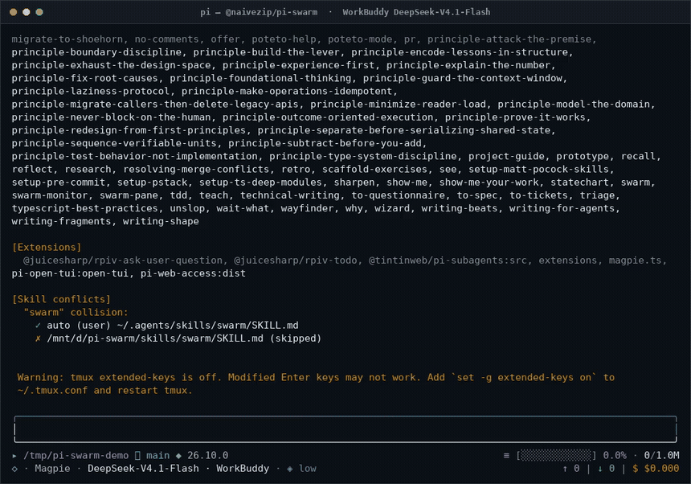

# @naivezip/pi-swarm

English | [简体中文](./README.zh.md)

Inspired by Antigravity's swarm, built for Pi.

Multi-agent swarm orchestration package for Pi (`@earendil-works/pi-coding-agent`), providing a shared message board, in-process SDK workers, isolated git workspaces, an async background shell with process management, a stall monitor scheduler, and an interactive TUI board overlay.

## Demo

Recorded live in Pi on WSL using `magpie / workbuddy/deepseek-v4.1-flash` (`math` + `strings` editing disjoint files in parallel, `verifier` extending tests and running `npm test` 11/11 pass, live TUI status widget, and `Alt+S` 3-tab Board Overlay):



[Download / watch full MP4 recording](https://raw.githubusercontent.com/naivezip/pi-swarm/main/assets/demo.mp4)

## Install

Published on [pi.dev](https://pi.dev) and npm as `@naivezip/pi-swarm`.

Install globally via Pi's package manager:

```bash
pi install npm:@naivezip/pi-swarm
```

Install project-locally (adds to `.pi/settings.json`):

```bash
pi install -l npm:@naivezip/pi-swarm
```

Try for a single session without saving to settings:

```bash
pi -e npm:@naivezip/pi-swarm
```

Manage installed packages:

```bash
pi list
pi update
pi remove npm:@naivezip/pi-swarm
```

Secondary options (GitHub or local development checkout):

```bash
pi install git:github.com/naivezip/pi-swarm
pi install ./path/to/pi-swarm
pi -e ./path/to/pi-swarm
```

## Commands & Shortcut

Swarm tools are registered with `defaultActive: false` so normal Pi sessions incur zero prompt or tool overhead until activated.

- `/swarm <task>`: Enables coordinator mode, activates the `swarm` tool, injects coordinator (`swarm`, `swarm-pane`) skill guidance, and sends `<task>` to the coordinator.
- `/swarm`: Opens the interactive Swarm Board Overlay if a swarm exists for the current session; otherwise enables coordinator mode (`swarm` tool).
- `/swarm ui`: Opens the 3-tab Swarm Board Overlay (or prints a plain-text summary in non-TUI modes).
- `/swarm stop`: Aborts all currently running workers and terminates their background processes without deleting their histories or workspaces.
- `/swarm off`: Deactivates coordinator mode and removes all 4 swarm tools from active tools (warns if workers are still running).
- `/swarm clean`: Removes stale swarm worktrees and clones from other sessions under `~/.pi/agent/swarms/`.
- `Alt+S`: Keyboard shortcut to open the Swarm Board Overlay when a swarm is active.

## Tools

Coordinator and worker sessions share four core tools (`post_message`, `read_board`, and `swarm_wait` activate for the coordinator as soon as the first worker is added or on session restore):

- `swarm`: Manage the swarm (`status`, `models`, `add`, `model`, `kill`, `title`, `channel`, `plan`).
  - `add`: Spawn a worker or sharded/homogeneous group (`tasks` / `n`), with optional `model`, `workspace` (`inherit` | `share` | `branch`), `fork` (`"coordinator"` or worker name), and `channels`.
  - `model`: Switch a `waiting` worker's (or own) model while preserving conversation history and resuming unfinished/errored turns.
  - `kill`: Permanently terminate a worker or group, clean up its background processes, and delete its `share`/`branch` workspace.
  - `channel`: `create`, `list`, `subscribe`, `unsubscribe`, `archive`.
  - `plan`: Persist structured goal/threads/tasks in `plan.json` for the TUI Overview tab.
- `post_message`: Post to `#main` or a subscribed channel; `@name`, `@group`, `@all`, and `@#channel` wake recipients (mentions inside code blocks are ignored; `@#main` is refused).
- `read_board`: Read visible board messages (`since`, `limit`, `channel`, or `status: true` for detailed roster, cursor, and active background process diagnostics).
- `swarm_wait`: Non-blocking park (`since`, `mentions_only`). Returns immediately if matching unread posts exist; otherwise registers the wait cursor so the host/runtime wakes the caller asynchronously on the next matching post.

Non-monitor workers receive an async background shell instead of Pi's blocking default `bash`:

- `bash`: Runs commands with sync-to-async promotion (`wait_ms`, default `10000`, max `30000`; `is_daemon`; `notify_after_seconds`, default `120`). Commands exiting within `wait_ms` return synchronously; longer commands promote to the background without being killed, return a `taskId` and output tail, and wake the owning worker asynchronously on `process_exit` or non-daemon `process_still_running`.
- `manage_process`: Inspect and control the worker's own background processes (`list`, `status`, `send_input`, `kill`), enforcing strict owner isolation and full process-tree termination.

Monitor workers (`monitor` or `monitor-<N>`) stay strictly read-only (no `bash`, `powershell`, `edit`, `write`, or `manage_process`) and receive:

- `schedule`: Create one-shot timers (`DurationSeconds`) or 5-field crons (`CronExpression`, `IsDaemon`).
- `manage_task`: List or kill scheduled monitor tasks.

## Skills

- `swarm` (`skills/swarm/SKILL.md`): Coordinator orchestration guide (delegation, workspaces, channels, addressing, non-blocking waiting, quota/rate-limit recovery).
- `swarm-monitor` (`skills/swarm-monitor/SKILL.md`): Stall-detection protocol for `monitor` workers, including distinguishing active non-daemon background builds from long-silent stuck processes and daemons.
- `swarm-pane` (`skills/swarm-pane/SKILL.md`): Concise `plan.json` structure for the TUI Overview tab.

## TUI Widget & Overlay

- **Persistent Widget** (`ctx.ui.setWidget("pi-swarm", ...)`): Displays swarm title, channel/post count, total active background processes (`N bg`), live worker states (`working`, `waiting`, `stopped`, `killed`), per-worker background process summaries (`N bg ([daemon] <preview>, <elapsed>)`), current tool activity or error tags, cumulative tokens/cost, and shortcut hint (`Alt+S` / `/swarm`).
- **Interactive Overlay** (`ctx.ui.custom(..., { overlay: true })`):
  - **Overview (`1`)**: Renders `plan.json` (`goal`, `threads`, assigned `tasks` with live worker status and `[N bg: ...]` badges) or falls back to a live roster and channels summary.
  - **Board (`2`)**: Scrollable feed with `@mention` highlighting, channel filter (`c`), member filter (`m`), and `r` / `Enter` to prefill `#<seq> ` into the coordinator editor.
  - **Workers (`3`)**: Worker list (with `[N bg]` badges) + live transcript, `Background Processes (N):` detail section (`taskId`, `[daemon]` tag, command, `elapsed` / `silent` durations), and safe actions: `k` (confirm & kill), `M` (switch model when waiting), `S` (stop all running workers).
  - Press `1`/`2`/`3`, `Tab`/`Shift+Tab`, or `Left`/`Right` to switch tabs; `Esc` or `q` to close.
- **Plain-Text Fallback**: Non-TUI modes (`print` / `json` / `rpc`) render a structured summary including `bg=N` counts and active process lines.

## Architecture

- `src/types.ts`: Canonical state, board, plan, scheduler, and background process types.
- `src/board.ts`: Append-only `board.jsonl`, atomic `state.json` and `plan.json` persistence under `~/.pi/agent/swarms/<sessionId>/`, channel visibility, and wake matching.
- `src/workspace.ts`: Git worktree (`share`), local git clone (`branch`), `inherit`, and stale workspace cleanup.
- `src/scheduler.ts`: 5-field cron and one-shot timer engine for monitor workers.
- `src/process-manager.ts`: `BackgroundProcessManager` providing sync-to-async `bash` promotion, rolling tail buffers with temp-file spillover, silence tracking, stdin delivery, cross-platform process-tree killing (`taskkill` on Windows, process groups on Unix), and owner-scoped lifecycle cleanup.
- `src/runtime.ts`: `SwarmManager` managing in-process `createAgentSession` workers, `DefaultResourceLoader({ noExtensions: true, extensionFactories: [createMcpExtension(), workerExtension] })`, branch-safe session forking, non-blocking parks, background process events (`process_exit` / `process_still_running`), and async wakeups.
- `src/tools.ts`: TypeBox tool definitions (`swarm`, `post_message`, `read_board`, `swarm_wait`, `schedule`, `manage_task`, `bash`, `manage_process`) and TUI call/result renderers.
- `src/ui.ts`: Throttled TUI widget, 3-tab interactive overlay with background process indicators, and non-TUI plain-text fallback.
- `extensions/index.ts`: Pi extension entry point (`defaultActive: false` tools, `/swarm` command, `Alt+S` shortcut, session restore/shutdown lifecycle, queued coordinator wakeup).
- `docs/specs/async_background_shell.qnt` & `docs/specs/async-background-shell.md`: Design spec and Quint formal specification verifying async background shell promotion, worker ownership/wake state machines, and coordinator wake delivery.

## Development

```bash
npm run typecheck
npm test
```
