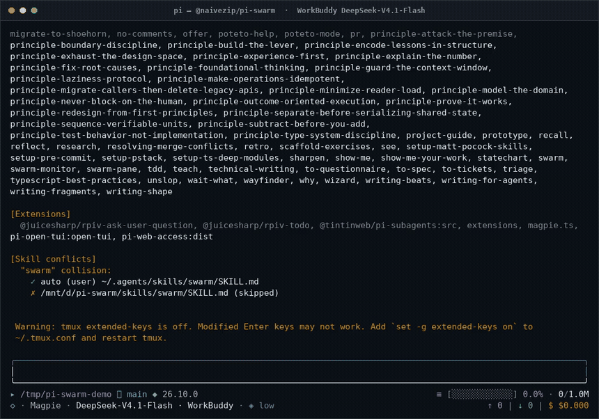

# @naivezip/pi-swarm

[English](./README.md) | 简体中文

灵感源自 Antigravity 的 Swarm 机制，专为 Pi 打造。

面向 Pi（`@earendil-works/pi-coding-agent`）的多 Agent 蜂群（Swarm）编排扩展包，提供共享消息看板、进程内 SDK Worker、隔离 Git 工作区、异步后台化 Shell 与进程管理、停滞监控调度器以及交互式 TUI 看板浮层。

## 演示

在 WSL 环境下基于 Pi 实机录制，使用 `magpie / workbuddy/deepseek-v4.1-flash`（`math` 与 `strings` 并行编辑互不冲突的文件，`verifier` 补充测试并运行 `npm test` 11/11 全部通过，搭配实时 TUI 状态组件与 `Alt+S` 三标签页看板浮层）：



[下载 / 观看完整 MP4 录屏](https://raw.githubusercontent.com/naivezip/pi-swarm/main/assets/demo.mp4)

## 安装

`@naivezip/pi-swarm` 已发布至 [pi.dev](https://pi.dev) 与 npm。

通过 Pi 包管理器全局安装：

```bash
pi install npm:@naivezip/pi-swarm
```

仅在当前项目安装（写入 `.pi/settings.json`）：

```bash
pi install -l npm:@naivezip/pi-swarm
```

单次会话临时试用（不写入配置文件）：

```bash
pi -e npm:@naivezip/pi-swarm
```

管理已安装的扩展包：

```bash
pi list
pi update
pi remove npm:@naivezip/pi-swarm
```

其他安装方式（GitHub 或本地开发目录）：

```bash
pi install git:github.com/naivezip/pi-swarm
pi install ./path/to/pi-swarm
pi -e ./path/to/pi-swarm
```

## 命令与快捷键

Swarm 工具默认以 `defaultActive: false` 注册，因此普通 Pi 会话在激活前不会产生任何提示词或工具上下文开销。

- `/swarm <task>`：启用协调者（Coordinator）模式，激活 `swarm` 工具，注入协调者技能指引（`swarm`、`swarm-pane`），并将 `<task>` 发送给协调者。
- `/swarm`：若当前会话已存在 Swarm，则打开交互式 Swarm 看板浮层；否则启用协调者模式（激活 `swarm` 工具）。
- `/swarm ui`：打开三标签页 Swarm 看板浮层（在非 TUI 模式下输出纯文本摘要）。
- `/swarm stop`：中止当前所有运行中的 Worker 并终止其后台进程，同时保留会话历史与工作区。
- `/swarm off`：退出协调者模式并从活跃工具中移除全部 4 个 Swarm 工具（若仍有 Worker 正在运行会发出提示）。
- `/swarm clean`：清理 `~/.pi/agent/swarms/` 下其他会话遗留的过期 worktree 与 clone 工作区。
- `Alt+S`：当 Swarm 处于活跃状态时，快速打开 Swarm 看板浮层。

## 工具

协调者与 Worker 会话共享四个核心工具（一旦添加第一个 Worker 或恢复会话，协调者会自动激活 `post_message`、`read_board` 和 `swarm_wait`）：

- `swarm`：管理 Swarm（`status`、`models`、`add`、`model`、`kill`、`title`、`channel`、`plan`）。
  - `add`：创建单个 Worker 或分片/同构 Worker 组（`tasks` / `n`），支持指定 `model`、`workspace`（`inherit` | `share` | `branch`）、`fork`（`"coordinator"` 或已有 Worker 名称）以及 `channels`。
  - `model`：为处于 `waiting` 状态的 Worker（或自身）切换模型，同时保留对话历史并继续未完成或报错中断的轮次。
  - `kill`：永久终止 Worker 或 Worker 组，自动清理其后台进程，并删除对应的 `share` / `branch` 工作区。
  - `channel`：`create`、`list`、`subscribe`、`unsubscribe`、`archive`。
  - `plan`：将结构化的目标、线程与任务写入 `plan.json`，供 TUI Overview 标签页展示。
- `post_message`：向 `#main` 或已订阅频道发送消息；使用 `@name`、`@group`、`@all` 和 `@#channel` 唤醒接收者（代码块内的 `@` 提及会被忽略，禁止使用 `@#main`）。
- `read_board`：读取可见看板消息（支持 `since`、`limit`、`channel`，或传入 `status: true` 获取成员状态、读取游标及活跃后台进程诊断信息）。
- `swarm_wait`：非阻塞挂起等待（`since`、`mentions_only`）。若已存在匹配的未读消息则立即返回；否则注册等待游标，由宿主/运行时在下一条匹配消息到达时异步唤醒调用方。

非监控类 Worker 会获得异步后台化 Shell 工具，替代 Pi 默认阻塞式的 `bash`：

- `bash`：支持“短命令同步返回、长命令自动转后台”的执行机制（`wait_ms` 默认 `10000`、上限 `30000`；`is_daemon`；`notify_after_seconds` 默认 `120`）。在 `wait_ms` 内退出的命令直接同步返回结果；超时未退出则不杀进程直接转入后台，立即返回 `taskId` 与当前输出尾部，并在进程退出（`process_exit`）或非守护进程超时仍在运行（`process_still_running`）时异步唤醒所属 Worker。
- `manage_process`：查看并控制 Worker 自己名下的后台进程（`list`、`status`、`send_input`、`kill`），严格执行归属隔离与整棵进程树终止。

监控 Worker（`monitor` 或 `monitor-<N>`）保持严格只读权限（不包含 `bash`、`powershell`、`edit`、`write` 与 `manage_process`），并独占以下工具：

- `schedule`：创建一次性定时器（`DurationSeconds`）或标准 5 段式 Cron 定时任务（`CronExpression`、`IsDaemon`）。
- `manage_task`：列出或终止已调度的监控定时任务。

## 技能（Skills）

- `swarm`（`skills/swarm/SKILL.md`）：协调者编排指南（任务拆解派发、工作区隔离、频道协作、精确 `@` 唤醒、非阻塞等待、额度/限流故障切换）。
- `swarm-monitor`（`skills/swarm-monitor/SKILL.md`）：`monitor` Worker 的停滞检测协议，支持区分正常推进中的非守护后台构建与长期静默卡死进程、守护进程。
- `swarm-pane`（`skills/swarm-pane/SKILL.md`）：用于驱动 TUI Overview 标签页的简洁 `plan.json` 结构规范。

## TUI 状态组件与浮层

- **常驻状态组件**（`ctx.ui.setWidget("pi-swarm", ...)`）：展示 Swarm 标题、频道/消息计数、全局活跃后台进程总数（`N bg`）、各 Worker 实时状态（`working`、`waiting`、`stopped`、`killed`）、单个 Worker 的后台进程摘要（`N bg ([daemon] <preview>, <elapsed>)`）、当前工具活动或错误标签、累计 Token/费用以及快捷键提示（`Alt+S` / `/swarm`）。
- **交互式浮层**（`ctx.ui.custom(..., { overlay: true })`）：
  - **Overview（`1`）**：基于 `plan.json` 渲染目标、线程与任务分配（含 Worker 实时状态与 `[N bg: ...]` 标记），若未设置计划则回退展示实时成员列表与频道摘要。
  - **Board（`2`）**：可滚动消息流，支持 `@mention` 高亮、频道过滤（`c`）、成员过滤（`m`），以及按 `r` / `Enter` 将 `#<seq> ` 预填至协调者输入框。
  - **Workers（`3`）**：Worker 列表（带 `[N bg]` 标记）+ 实时对话记录、`Background Processes (N):` 详情区域（含 `taskId`、`[daemon]` 标记、命令、已运行时长 `elapsed` 与静默时长 `silent`），以及安全操作：`k`（确认后终止）、`M`（waiting 时切换模型）、`S`（停止所有运行中的 Worker）。
  - 支持 `1`/`2`/`3`、`Tab`/`Shift+Tab` 或 `Left`/`Right` 切换标签页；`Esc` 或 `q` 关闭浮层。
- **纯文本回退**：非 TUI 模式（`print` / `json` / `rpc`）下会输出包含 `bg=N` 计数与活跃后台进程明细的结构化文本摘要。

## 架构概览

- `src/types.ts`：核心状态、消息看板、计划、调度器与后台进程类型定义。
- `src/board.ts`：基于 `~/.pi/agent/swarms/<sessionId>/` 的追加写 `board.jsonl`、原子写入 `state.json` 与 `plan.json`、频道可见性及唤醒匹配逻辑。
- `src/workspace.ts`：Git worktree（`share`）、本地 Git clone（`branch`）、`inherit` 工作区管理及过期工作区清理。
- `src/scheduler.ts`：面向监控 Worker 的 5 段式 Cron 与一次性定时器引擎。
- `src/process-manager.ts`：`BackgroundProcessManager`，负责同步转后台竞争、滚动尾部输出缓冲与大日志落盘、无输出静默计时、标准输入投递、跨平台进程树查杀（Windows 下使用 `taskkill`，类 Unix 下使用进程组）及按归属清理生命周期。
- `src/runtime.ts`：`SwarmManager`，管理进程内 `createAgentSession` Worker、`DefaultResourceLoader({ noExtensions: true, extensionFactories: [createMcpExtension(), workerExtension] })`、分支安全会话 Fork、非阻塞挂起、后台进程事件（`process_exit` / `process_still_running`）及异步唤醒。
- `src/tools.ts`：TypeBox 工具定义（`swarm`、`post_message`、`read_board`、`swarm_wait`、`schedule`、`manage_task`、`bash`、`manage_process`）及 TUI 调用/结果渲染器。
- `src/ui.ts`：节流刷新的 TUI 状态组件、支持后台进程状态展示的三标签页交互式浮层及非 TUI 纯文本回退。
- `extensions/index.ts`：Pi 扩展入口（`defaultActive: false` 工具注册、`/swarm` 命令、`Alt+S` 快捷键、会话恢复/关闭生命周期、协调者唤醒排队与补发）。
- `docs/specs/async_background_shell.qnt` 与 `docs/specs/async-background-shell.md`：异步后台化 Shell 晋升、Worker 归属/唤醒状态机及协调者唤醒投递的设计规范与 Quint 形式化规约。

## 开发

```bash
npm run typecheck
npm test
```
